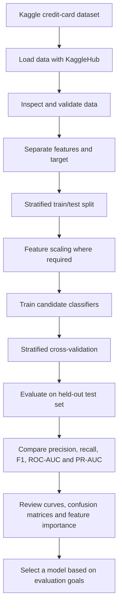
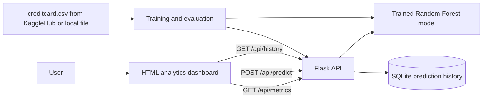

<div align="center">

# FraudLens AI
### Credit Card Fraud Detection · Model Benchmarking · Analytics Dashboard

**A machine-learning project for identifying potentially fraudulent credit-card transactions in a highly imbalanced dataset.**

[Dataset](https://www.kaggle.com/datasets/mlg-ulb/creditcardfraud) · [GitHub Pages Guide](#-publish-the-static-dashboard-with-github-pages) · [Run Locally](#-run-locally)

</div>

---

## Overview

FraudLens AI explores credit-card transaction fraud detection using supervised machine learning. It combines a Jupyter notebook for data analysis and model comparison with a dashboard concept for reviewing evaluation metrics and testing predictions through a Flask API.

Fraud detection is an imbalanced classification problem: fraudulent transactions make up a very small fraction of all transactions. For that reason, accuracy alone can be misleading. This project also evaluates precision, recall, F1-score, ROC-AUC and Precision–Recall performance.

> **Important:** This is an educational and experimental project, not a production banking or payment-security system. Dashboard predictions are only as meaningful as the model, preprocessing and input features supplied.

## Project goals

- Load the public credit-card fraud dataset from Kaggle without committing the large dataset to this repository.
- Inspect the data and prepare features for modelling.
- Compare Logistic Regression, Random Forest, AdaBoost and K-Nearest Neighbors (KNN).
- Evaluate models using stratified train/test splitting and cross-validation.
- Visualize model performance with metric comparisons, ROC and Precision–Recall curves, confusion matrices and feature importance where supported.
- Provide a Flask API and HTML dashboard for metrics, sample predictions and prediction history.

## Dataset

**Source:** [Credit Card Fraud Detection — Kaggle](https://www.kaggle.com/datasets/mlg-ulb/creditcardfraud)

The dataset contains European cardholder transactions from September 2013. Its common version contains **284,807 rows and 31 columns**:

- `Time`: seconds elapsed between a transaction and the first transaction in the dataset.
- `V1`–`V28`: anonymized numerical features produced using PCA.
- `Amount`: transaction amount.
- `Class`: target label (`0` = legitimate, `1` = fraudulent).

The target is highly imbalanced. Use precision, recall, F1-score and Precision–Recall AUC alongside ROC-AUC, and examine false positives and false negatives rather than relying on accuracy alone.

The dataset is **not stored in this repository**. The notebook downloads it with KaggleHub, which keeps downloaded files in a local cache. On first use, internet access and any Kaggle access requirements may apply.

## Workflow



### Application architecture



The notebook and web app are separate entry points:

- **Notebook:** performs exploratory analysis, trains and compares multiple classifiers, and presents evaluation results.
- **Flask app (`app.py`):** trains a Random Forest baseline when a local `creditcard.csv` exists, exposes API routes, and stores prediction history in SQLite.
- **HTML dashboard:** calls the Flask endpoints to display metrics, submit predictions and retrieve history.

The Flask app currently expects `creditcard.csv` in its working directory. KaggleHub loading is implemented in the notebook; it is **not automatically used by `app.py`**. Follow the local setup below or modify the app to download the data before launching it.

## Models and evaluation

The notebook benchmarks:

| Model | Purpose |
|---|---|
| Logistic Regression | Linear baseline; configured with class weighting |
| Random Forest | Non-linear ensemble; configured with class weighting |
| AdaBoost | Boosting-based classifier |
| K-Nearest Neighbors (KNN) | Distance-based baseline |

The notebook uses a stratified split and Stratified K-Fold cross-validation. Scaling is applied in the notebook; ensure that preprocessing is fitted only on training data to avoid data leakage.

**Metrics to interpret:**

- **Precision:** Of transactions predicted as fraud, how many were fraud?
- **Recall:** Of all actual fraud cases, how many did the model identify?
- **F1-score:** Harmonic mean of precision and recall.
- **ROC-AUC:** Ability to rank positive cases above negative cases across thresholds.
- **PR-AUC / Average Precision:** Often especially informative when the positive class is rare.
- **Confusion matrix:** Shows true/false positives and true/false negatives.

No benchmark scores are hard-coded in this README; run the notebook to generate results in your environment.

## Repository structure

```text
mini/
├── app.py
├── credit_card_fraud_detection_notebook.ipynb
├── credit_card_fraud_detection_notebook.html
├── model_evaluation_fraud_detection_dashboard.html
├── requirements.txt
├── README.md
└── fraud_analytics.db          # Local runtime database; usually do not commit
```

`creditcard.csv` is downloaded or supplied locally and should remain untracked by Git.

## Run locally

### 1. Clone the repository

```bash
git clone <YOUR_REPOSITORY_URL>
cd <YOUR_REPOSITORY_FOLDER>
```

### 2. Create and activate a virtual environment

**Windows PowerShell**
```powershell
py -m venv .venv
.\.venv\Scripts\Activate.ps1
```

**macOS / Linux**
```bash
python3 -m venv .venv
source .venv/bin/activate
```

### 3. Install dependencies

```bash
python -m pip install --upgrade pip
pip install -r requirements.txt
```

### 4. Run the notebook

Open `credit_card_fraud_detection_notebook.ipynb` in Jupyter Notebook, JupyterLab or VS Code. Run the cells from top to bottom. The notebook downloads the dataset using KaggleHub.

If Kaggle asks you to authenticate or accept dataset terms, complete those steps with your own Kaggle account. Never commit Kaggle API tokens or credentials.

### 5. Run the Flask dashboard locally

The current `app.py` expects a file named `creditcard.csv` in the project directory. Download the dataset from Kaggle and place the CSV there (or update `app.py` to use the KaggleHub cache path).

Then run:

```bash
python app.py
```

Open **http://127.0.0.1:5000** in your browser. The initial model training can take time. The application creates `fraud_analytics.db` to store prediction history.

The dashboard exposes these endpoints:

| Method | Endpoint | Purpose |
|---|---|---|
| `GET` | `/api/metrics` | Model evaluation metrics |
| `POST` | `/api/predict` | Predict a transaction using supplied feature values |
| `GET` | `/api/history` | Recent prediction history |

### Prediction input caveat

The current dashboard API accepts `Amount`, `Time`, and optional `V1`–`V28` fields. Any omitted features are set to zero. This is convenient for a demo, but arbitrary zero-filled features may not represent a realistic transaction. Predictions should not be interpreted as reliable financial decisions.

## Publish the static dashboard with GitHub Pages

GitHub Pages serves static files such as HTML, CSS and JavaScript. It **does not run Python, Flask, scikit-learn, or SQLite**.

1. Push the repository to GitHub. Make sure `creditcard.csv`, Kaggle credentials, virtual environments and local database files are not committed.
2. Open the repository on GitHub.
3. Go to **Settings → Pages**.
4. Under **Build and deployment**, choose **Deploy from a branch**.
5. Select your branch (usually `main`) and the folder containing the site (`/ (root)` if the HTML file is in the repository root).
6. Click **Save** and wait for GitHub to publish the site.
7. Open the Pages URL shown in Settings → Pages.

### What will work on Pages?

- The static HTML dashboard file can be published and viewed.
- The Flask API routes and SQLite-backed prediction history will **not** work on GitHub Pages.
- Since this dashboard calls `/api/metrics`, `/api/predict` and `/api/history`, its live metrics and prediction features require a separately hosted backend. On Pages, the backend status may remain disconnected and API-dependent panels may stay empty.

For a frontend-only portfolio preview, create a separate static page or adapt the dashboard to use pre-generated JSON results and disable live prediction/history controls. To run the complete interactive application, host the Flask backend on a Python-capable hosting service and configure the frontend to call that backend's URL. Do not put secrets or private credentials in frontend code.

## Git hygiene

Create a `.gitignore` file in the repository root:

```gitignore
# Dataset and archives
creditcard.csv
*.zip

# Python environments and cache
.venv/
venv/
__pycache__/
*.py[cod]

# Local runtime database (if it contains personal/test history)
fraud_analytics.db
fraud_analytics.db-journal

# Secrets
.env
.kaggle/
kaggle.json

# Notebook checkpoints
.ipynb_checkpoints/
```

If the dataset or database has already been committed, adding `.gitignore` does not remove it from Git history. Stop tracking it with `git rm --cached <filename>` and commit the change. If a large dataset was pushed in earlier commits, it may still remain in repository history.

## Responsible use and limitations

- This project is for learning, experimentation and demonstration.
- An anonymized dataset may not represent present-day transaction behaviour or every population.
- Class imbalance makes accuracy alone insufficient.
- Model performance depends on preprocessing, feature availability, threshold choice and data drift.
- The dashboard's zero-filled missing features can make predictions unrealistic.
- Do not use the project to approve, reject or investigate real transactions without extensive validation, security, privacy, monitoring and human oversight.

## Future improvements

- Use an end-to-end scikit-learn `Pipeline` so preprocessing is consistently applied at training and prediction time.
- Persist the trained model and scaler instead of retraining on every application startup.
- Add threshold tuning, calibration and cost-sensitive evaluation.
- Validate API inputs and use a realistic, clearly documented transaction-input workflow.
- Add automated tests and a reproducible training script.
- Separate static dashboard hosting from backend API hosting.
- Add model versioning, drift monitoring and a clear model card.

## Acknowledgements

- Dataset: [Machine Learning Group — ULB, hosted on Kaggle](https://www.kaggle.com/datasets/mlg-ulb/creditcardfraud)
- Libraries: pandas, NumPy, scikit-learn, Matplotlib, Seaborn, Flask and SQLite.

---

<div align="center">

**FraudLens AI** · Built for machine-learning practice and model evaluation.

</div>
# FraudLens

# TrustLens

